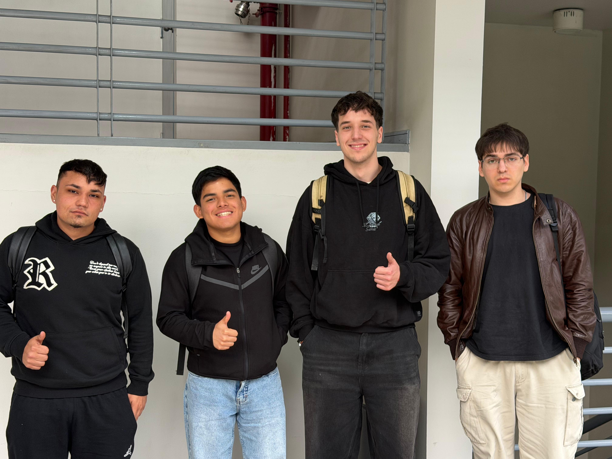
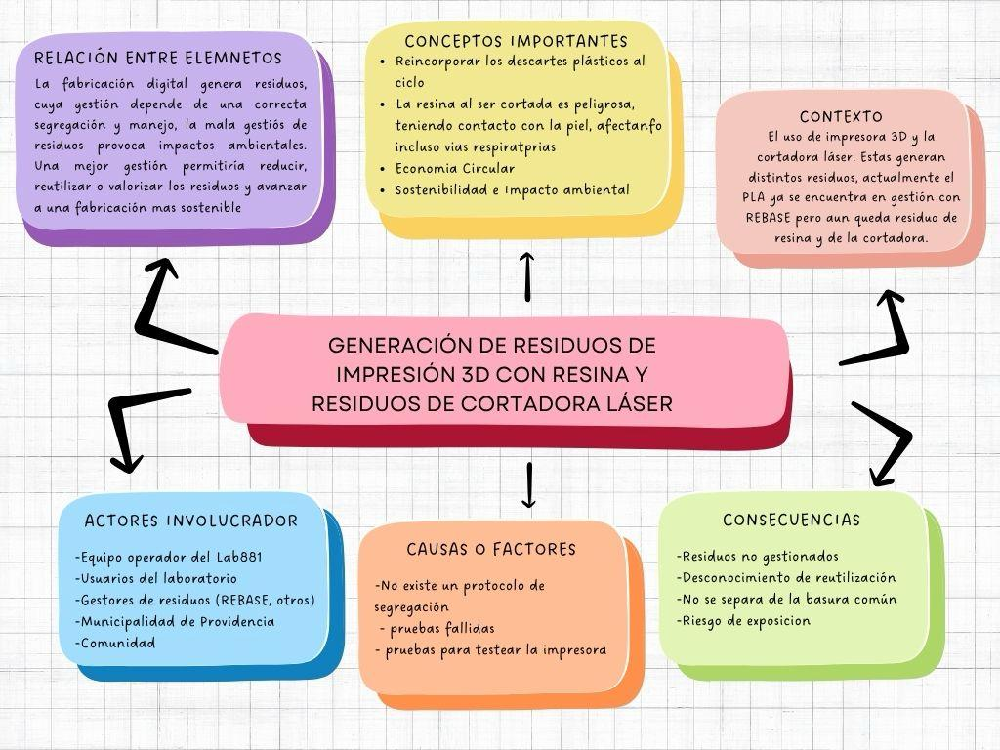
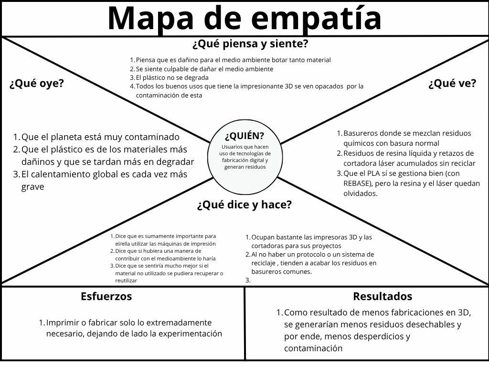

# EcoFab Lab - Bitácora Capstone

## Capstone Intermedio 2026

**Equipo:** EcoFab Lab  
**Desafío:** 05 | Sostenibilidad - Circularidad y manejo de residuos de fabricación digital  
**Contraparte:** Municipalidad de Providencia / Hub Providencia - Lab881  
**Estado actual:** Etapa de comprensión, diagnóstico y análisis de alternativas  
**Última sesión registrada:** S10 - 15.10.2026

---

## Descripción

Nuestro proyecto aborda el Desafío 05 de Sostenibilidad, centrado en la circularidad y el manejo de residuos generados por procesos de fabricación digital en el Lab881 de Providencia.

Actualmente, nuestro equipo busca comprender cómo se generan y gestionan los residuos del laboratorio, identificando aquellos flujos que presentan mayores dificultades y que podrían representar una oportunidad de mejora.

Inicialmente, el análisis se ha enfocado en los residuos asociados a la impresión 3D con resina y a la cortadora láser, sin descartar otros flujos que puedan resultar relevantes durante el diagnóstico.

A lo largo de las sesiones hemos trabajado en la comprensión del problema, la identificación de actores, la exploración de primeras posibilidades y el análisis de alternativas. También hemos considerado la importancia de contrastar nuestras ideas con las condiciones reales del laboratorio y las necesidades de la contraparte.

Durante las últimas sesiones, la continuidad de las actividades académicas se ha visto afectada por el paro universitario, por lo que quedan tareas de coordinación y consulta que deberán retomarse cuando existan las condiciones para continuar.

La intención es seleccionar una alternativa técnicamente viable, fundamentada en evidencia y que contribuya a mejorar la gestión de un flujo específico de residuos del Lab881.

---

## Equipo

| Integrante | Carrera o especialidad | Rol inicial | Usuario de GitHub |
|---|---|---|---|
| José Obrecht Egaña | Ingeniería Civil Industrial | Coordinación y seguimiento | JoseObrecht123 |
| Marco Díaz Estrada | Ingeniería Civil en Computación e Informática | Investigación y diagnóstico | [@usuario] |
| Piero Valdivia Meneses | Ingeniería Civil en Computación e Informática | Diseño y prototipado | piierv |
| Paulo García Arce | Ingeniería Civil en Computación e Informática | Documentación y análisis | yelol123 |

---

## Valores del equipo

- Respeto
- Responsabilidad
- Comunicación
- Compromiso
- Colaboración
- Proactividad
- Creatividad
- Sostenibilidad

---

## Normas de funcionamiento

1. Mantener una comunicación constante entre los integrantes.
2. Cumplir las tareas y plazos acordados por el equipo.
3. Avisar oportunamente si un integrante no puede cumplir un compromiso.
4. Distribuir las tareas de manera equilibrada.
5. Escuchar y respetar las opiniones de todos.
6. Revisar los avances antes de realizar una entrega.
7. Registrar decisiones, avances y evidencias en la bitácora.
8. Resolver los desacuerdos mediante conversación y búsqueda de consenso.
9. Si no se alcanza un acuerdo, solicitar orientación al docente.
10. Priorizar el objetivo común por sobre las tareas individuales.

---

# Desafío

## Pregunta orientadora

> ¿Cómo podríamos mejorar la gestión de los residuos generados por los procesos de fabricación digital del Lab881, especialmente aquellos asociados a la impresión 3D con resina y a la cortadora láser?

---

## Lo que sabemos actualmente

- La fabricación digital genera distintos tipos de residuos, como piezas defectuosas, soportes, materiales sobrantes y restos asociados a los procesos de producción.
- El PLA ya cuenta con una alternativa de gestión mediante convenio con REBASE.
- Los residuos provenientes de la impresión 3D con resina y de la cortadora láser requieren mayor investigación.
- Es necesario comprender los procedimientos actuales de segregación, almacenamiento y disposición.
- La selección del flujo prioritario debe basarse en evidencia y no solamente en supuestos iniciales.
- La factibilidad de cualquier alternativa dependerá de las condiciones técnicas, económicas y de seguridad del laboratorio.

---

## Lo que necesitamos investigar

- ¿Qué flujo representa actualmente la mayor dificultad de gestión?
- ¿Qué cantidad de residuos se genera?
- ¿Con qué frecuencia se generan?
- ¿Cómo se separan actualmente?
- ¿Cómo y dónde se almacenan?
- ¿Quién se encarga actualmente de su manejo?
- ¿Qué residuos pueden ser reutilizados o valorizados?
- ¿Qué restricciones de seguridad existen?
- ¿Qué alternativas de gestión existen actualmente?
- ¿Qué recursos y condiciones serían necesarios para implementar una mejora?

---

## Definición actual del desafío

Como equipo EcoFab Lab abordaremos la gestión de residuos derivados de procesos de fabricación digital del Lab881.

La primera parte del proyecto se ha centrado en comprender el problema, reconocer los actores involucrados y explorar posibles líneas de trabajo. El siguiente paso consiste en consolidar la información disponible, resolver las dudas pendientes y caracterizar el flujo de residuos que presente una oportunidad de mejora relevante.

Posteriormente, se seleccionará una alternativa específica que pueda evaluarse mediante criterios de viabilidad técnica, seguridad, sostenibilidad y potencial de mejora.

---

# Usuarios y actores

## Usuario principal inicial

**Equipo operador del Lab881.**

Este usuario fue seleccionado durante la elaboración del mapa de empatía debido a su relación directa con las máquinas, los materiales, las personas usuarias y los residuos generados durante el funcionamiento cotidiano del laboratorio.

Comprender su experiencia es importante para identificar dificultades prácticas, procedimientos existentes y oportunidades de mejora que puedan incorporarse al proyecto.

## Otros usuarios y actores

- Personas usuarias del Lab881.
- Municipalidad de Providencia / Hub Providencia.
- Gestores de residuos.
- Proveedores de materiales.
- Comunidad vinculada a actividades de fabricación digital.

---

# Objetivo SMART del equipo

Diseñar y validar, antes de la entrega final del proyecto, una alternativa técnicamente viable para reducir la generación o mejorar la segregación, reutilización, valorización o gestión segura de un flujo de residuos de fabricación digital del Lab881, utilizando un diagnóstico cuantificado y desarrollando un prototipo, procedimiento o piloto que permita demostrar su potencial de mejora respecto de la situación actual.

---

# Compromisos individuales

| Integrante | Compromiso SMART |
|---|---|
| José Obrecht Egaña | Coordinar el trabajo del equipo, registrar acuerdos, responsables y fechas, y realizar seguimiento de los compromisos durante las etapas del proyecto. |
| Marco Díaz Estrada | Investigar y caracterizar el flujo de residuos seleccionado, recopilando antecedentes y apoyando la elaboración de un diagnóstico cuantificado. |
| Piero Valdivia Meneses | Participar en la generación y selección de alternativas y desarrollar, junto al equipo, un prototipo o procedimiento que permita evaluar la factibilidad técnica de la propuesta. |
| Paulo García Arce | Organizar las evidencias, datos, fotografías y resultados del proyecto, manteniendo actualizada la bitácora y apoyando el análisis de la situación actual frente a la alternativa propuesta. |

---

# Avance del proyecto

| Sesión | Fecha | Actividad principal | Estado |
|---|---|---|---|
| S02 | 20.08.2026 | Formación del equipo, distribución de roles y definición inicial del desafío | Completado |
| S03 | 27.08.2026 | Mapa conceptual, mapa de empatía y comprensión del problema | Completado |
| S04 | 03.09.2026 | Trofeo Mayor y primeras posibilidades | Registrado en bitácora |
| S05 | 10.09.2026 | Primera presentación con nota | Registrado en bitácora |
| S06 | 17.09.2026 | Semana de receso: pausa y planificación (Fiestas Patrias) | Receso académico |
| S07 | 24.09.2026 | Visita al Hub Providencia: levantamiento de datos en terreno | Registrado en bitácora |
| S08 | 01.10.2026 | Reflexión con los datos: análisis y viabilidad de la solución | Registrado en bitácora |
| S09 | 08.10.2026 | Nuevas dudas y consultas a la contraparte (Hub Providencia) | Afectado por paro universitario |
| S10 | 15.10.2026 | Continuidad del paro universitario | Afectado por paro universitario |

---

# Índice de la bitácora

- [S02 - Identidad del equipo y desafío](bitacora/S02.md)
- [S03 - Comprensión del problema: mapa conceptual y mapa de empatía](bitacora/S03.md)
- [S04 - Trofeo Mayor y primeras posibilidades](bitacora/S04.md)
- [S05 - Primera presentación con nota](bitacora/S05.md)
- [S06 - Semana de receso: pausa y planificación (Fiestas Patrias)](bitacora/S06.md)
- [S07 - Visita al Hub Providencia: levantamiento de datos en terreno](bitacora/S07.md)
- [S08 - Reflexión con los datos: análisis y viabilidad de la solución](bitacora/S08.md)
- [S09 - Nuevas dudas y consultas a la contraparte (Hub Providencia)](bitacora/S09.md)
- [S10 - Continuidad del paro universitario](bitacora/S10.md)

---

# Evidencias por sesión

## S02 - 20.08.2026

Durante la primera sesión se conformó el equipo, se distribuyeron los roles iniciales y se realizó una primera interpretación del desafío.

---

## S03 - 27.08.2026

Durante esta sesión trabajamos en la comprensión del problema mediante la construcción de un mapa conceptual y un mapa de empatía.

### Trabajo del equipo

### Mapa conceptual

### Mapa de empatía

---

## S04 - 03.09.2026

### Trofeo Mayor y primeras posibilidades

Durante esta sesión se abordó la actividad denominada Trofeo Mayor y se exploraron primeras posibilidades para continuar trabajando en el desafío.

Esta etapa se relaciona con la búsqueda de alternativas para abordar la gestión de residuos, manteniendo como prioridad comprender las características del problema antes de definir una solución definitiva.

Las posibilidades consideradas deben contrastarse con los antecedentes del laboratorio y con las condiciones reales de operación.

### Aspectos relevantes

- Continuar delimitando el problema.
- Explorar posibles enfoques de mejora.
- Identificar información que todavía falta.
- Evitar seleccionar una alternativa sin contar con antecedentes suficientes.

### Evidencias

Agregar las fotografías, apuntes y resultados correspondientes a la sesión.

---

## S05 - 10.09.2026

### Primera presentación con nota

Esta sesión corresponde a la primera presentación evaluada del proyecto.

La instancia tuvo como propósito comunicar el avance del equipo y presentar los antecedentes desarrollados hasta ese momento, incluyendo la comprensión inicial del desafío, los actores identificados y las preguntas que orientan el diagnóstico.

La presentación representa un punto de revisión para reconocer los aspectos que deben fortalecerse y orientar el trabajo posterior.

### Aspectos por considerar

- Revisar la retroalimentación recibida.
- Identificar los elementos que requieren mayor claridad.
- Mejorar la fundamentación del problema.
- Organizar las tareas necesarias para continuar con el diagnóstico.

### Evidencias

Agregar la presentación utilizada, la pauta de evaluación y los comentarios recibidos.

---

## S06 - 17.09.2026

### Semana de receso: pausa y planificación (Fiestas Patrias)

Esta semana corresponde al receso asociado a las celebraciones de Fiestas Patrias.

El receso representa una pausa en las actividades académicas habituales. Para mantener la continuidad del proyecto, resulta importante conservar los avances registrados y tener presentes las tareas pendientes para retomar el trabajo.

### Pendientes para retomar

- Revisar los avances de las sesiones anteriores.
- Preparar preguntas para la contraparte.
- Organizar las necesidades de información para el diagnóstico.
- Considerar los aspectos que deben observarse durante el levantamiento de datos.

### Evidencias

Registrar las actividades de planificación efectivamente realizadas durante el receso, si corresponde.

---

## S07 - 24.09.2026

### Visita al Hub Providencia: levantamiento de datos en terreno

Esta sesión se orienta al acercamiento al contexto real del Lab881 y al levantamiento de información sobre los procesos de fabricación digital y sus residuos.

La visita constituye una instancia relevante para contrastar las ideas iniciales del equipo con las condiciones de funcionamiento del laboratorio. El objetivo es comprender cómo se generan los residuos, qué procedimientos se utilizan para manejarlos y cuáles son las principales dificultades que deben considerarse.

Se mantiene el interés en los flujos asociados a la impresión 3D con resina y a la cortadora láser, sin descartar otros residuos que puedan presentar dificultades relevantes.

### Información relevante para el diagnóstico

- Tipos de residuos generados.
- Cantidades y frecuencia de generación, cuando exista información disponible.
- Procedimientos actuales de segregación.
- Formas y lugares de almacenamiento.
- Responsables del manejo.
- Restricciones técnicas y de seguridad.
- Dificultades operativas y oportunidades de mejora.

### Evidencias

Agregar las fotografías autorizadas, los apuntes de terreno y los antecedentes recopilados durante la visita.

---

## S08 - 01.10.2026

### Reflexión con los datos: análisis y viabilidad de la solución

En esta etapa el trabajo se orienta a revisar los antecedentes disponibles y analizar cómo pueden utilizarse para avanzar hacia una solución pertinente.

La reflexión debe permitir identificar qué información resulta útil para comprender el problema, qué dudas permanecen abiertas y qué criterios deberían considerarse al comparar posibles alternativas.

La selección del flujo prioritario requiere evaluar su relevancia, la posibilidad de medir mejoras, las restricciones de seguridad y los recursos necesarios para implementar una propuesta.

### Criterios para evaluar alternativas

- Magnitud y frecuencia de generación del residuo.
- Dificultad de su gestión actual.
- Posibilidades de reducción, reutilización o valorización.
- Viabilidad técnica de la alternativa.
- Requisitos de seguridad y almacenamiento.
- Recursos necesarios para implementar y evaluar la propuesta.
- Potencial de mejora respecto de la situación actual.

### Próximos pasos

Consolidar los antecedentes disponibles, identificar las brechas de información y preparar las consultas necesarias para la contraparte.

### Evidencias

Agregar los datos, comparaciones, apuntes y conclusiones efectivamente obtenidos durante la sesión.

---

## S09 - 08.10.2026

### Nuevas dudas y consultas a la contraparte (Hub Providencia)

Durante esta etapa se identifican preguntas que necesitan respuesta para continuar delimitando el problema y evaluar la viabilidad de una alternativa.

Las dudas pueden relacionarse con los procedimientos actuales de manejo de residuos, las restricciones de seguridad, los recursos disponibles y las condiciones que debería cumplir una propuesta para ser aplicable al laboratorio.

Sin embargo, el desarrollo habitual de las actividades académicas se vio afectado por el paro universitario, lo que condicionó la continuidad del trabajo y la coordinación prevista.

### Consultas pendientes

- Confirmar los procedimientos actuales de gestión de residuos.
- Aclarar las restricciones técnicas y de seguridad.
- Verificar qué alternativas podrían ser viables para el laboratorio.
- Identificar los datos adicionales necesarios para cuantificar el problema.
- Determinar qué condiciones debe cumplir una propuesta de mejora.

### Próximos pasos

Retomar las consultas con la contraparte cuando sea posible, organizar las preguntas pendientes y mantener documentados los avances anteriores.

### Evidencias

Agregar las consultas preparadas, las respuestas recibidas si las hubo y los antecedentes relacionados con la interrupción de las actividades.

---

## S10 - 15.10.2026

### Continuidad del paro universitario

Durante esta semana continuó el contexto de paro universitario que había afectado la sesión anterior, dificultando la continuidad habitual de las actividades académicas y de coordinación del proyecto.

En consecuencia, el equipo mantiene como referencia los avances de comprensión y diagnóstico desarrollados durante las sesiones anteriores, mientras quedan pendientes actividades que requieren coordinación, retroalimentación o comunicación con la contraparte.

Esta situación refuerza la importancia de mantener la bitácora actualizada y conservar organizados los antecedentes recopilados, de manera que el proyecto pueda retomarse sin perder el seguimiento de las tareas.

### Actividades pendientes

- Retomar las consultas al Hub Providencia.
- Completar los antecedentes que falten del diagnóstico.
- Revisar los datos disponibles sobre los residuos.
- Evaluar las alternativas desde los criterios técnicos y de seguridad.
- Coordinar los siguientes pasos con el equipo.
- Definir las acciones necesarias para continuar con el proyecto.

### Evidencias

Agregar los comunicados oficiales o antecedentes disponibles que permitan documentar la suspensión o modificación de las actividades, cuando corresponda.

---

# Decisiones relevantes

| Fecha | Decisión o criterio | Evidencia o fundamento |
|---|---|---|
| 20.08.2026 | Conformación del equipo y distribución de roles | Reunión inicial de Capstone |
| 20.08.2026 | Abordar residuos de fabricación digital con foco en los flujos de mayor dificultad | Ficha del Desafío 05 |
| 27.08.2026 | Mantener inicialmente el análisis sobre impresión 3D con resina y cortadora láser | Mapa conceptual |
| 27.08.2026 | Considerar al equipo operador del Lab881 como usuario principal inicial | Mapa de empatía |
| 27.08.2026 | Priorizar la comprensión y validación del problema antes de definir una solución | Ejercicio de comprensión del problema |
| 03.09.2026 | Explorar primeras posibilidades para abordar el desafío | Actividad Trofeo Mayor |
| 10.09.2026 | Presentar el avance del proyecto en una instancia evaluada | Primera presentación con nota |
| 17.09.2026 | Considerar el receso de Fiestas Patrias en la planificación | Calendario académico |
| 24.09.2026 | Considerar el contexto real del laboratorio como parte del diagnóstico | Visita al Hub Providencia |
| 01.10.2026 | Analizar los antecedentes disponibles antes de seleccionar una alternativa | Actividad de reflexión y análisis |
| 08.10.2026 | Organizar las dudas y consultas pendientes para la contraparte | Necesidades de información identificadas |
| 15.10.2026 | Mantener registrados los pendientes ante la continuidad del paro universitario | Seguimiento del proyecto |

---

# Próximo hito

Retomar el trabajo de diagnóstico y coordinación, priorizando las consultas pendientes a la contraparte y la consolidación de la información disponible sobre los residuos generados en el Lab881.

Se buscará conocer principalmente:

- Tipos de residuos.
- Cantidades generadas y frecuencia.
- Forma actual de segregación.
- Almacenamiento y disposición.
- Principales dificultades para los operadores.
- Restricciones de seguridad.
- Alternativas técnicamente viables.

Esta información permitirá seleccionar un flujo específico respaldado por evidencia y definir una propuesta que pueda evaluarse mediante un prototipo, procedimiento o piloto.

---

# Uso y licencia

Por definir con el equipo docente y la contraparte.

No publicar información reservada, datos personales o material sensible sin autorización.
