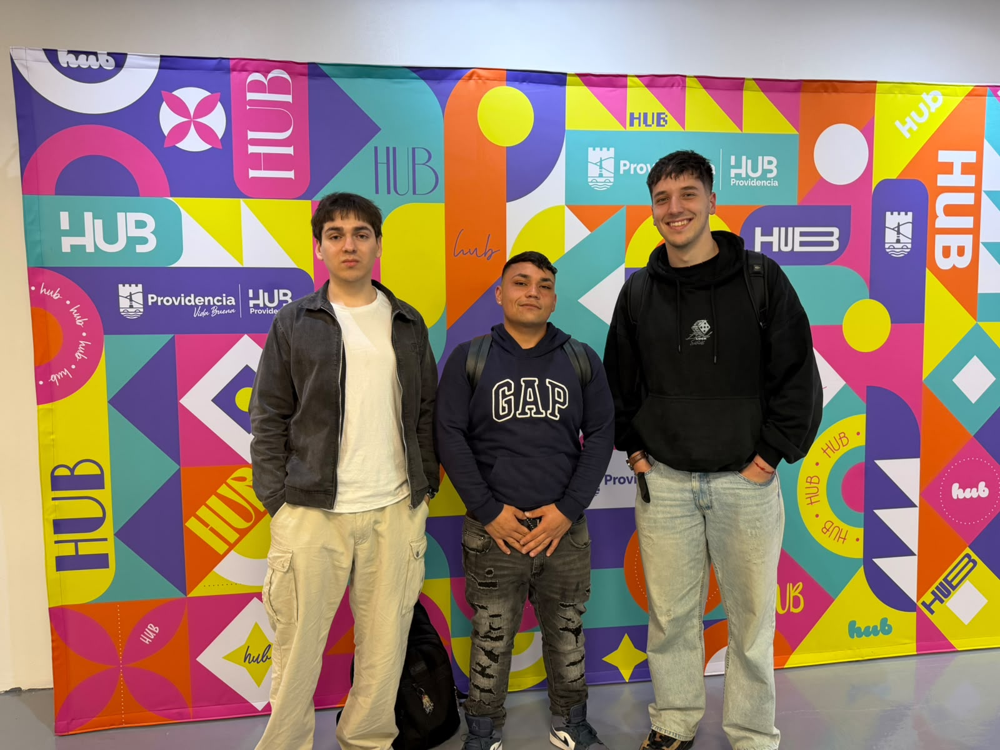

EcoFab Lab - Bitácora Capstone
Capstone Intermedio 2026
Equipo: EcoFab Lab
Desafío: 05 | Sostenibilidad - Circularidad y manejo de residuos de fabricación digital
Contraparte: Municipalidad de Providencia / Hub Providencia - Lab881
Estado actual: Etapa de comprensión, diagnóstico y análisis de alternativas
Última sesión registrada: S10 - 15.10.2026
---
Descripción
Nuestro proyecto aborda el Desafío 05 de Sostenibilidad, centrado en la circularidad y el manejo de residuos generados por procesos de fabricación digital en el Lab881 de Providencia.
Actualmente, nuestro equipo busca comprender cómo se generan y gestionan los residuos del laboratorio, identificando aquellos flujos que presentan mayores dificultades y que podrían representar una oportunidad de mejora.
Inicialmente, el análisis se ha enfocado en los residuos asociados a la impresión 3D con resina y a la cortadora láser, sin descartar otros flujos que puedan resultar relevantes durante el diagnóstico.
A lo largo de las sesiones hemos trabajado en la comprensión del problema, la identificación de actores, la exploración de primeras posibilidades y el análisis de alternativas. También hemos considerado la importancia de contrastar nuestras ideas con las condiciones reales del laboratorio y las necesidades de la contraparte.
Durante las últimas sesiones, la continuidad de las actividades académicas se ha visto afectada por el paro universitario, por lo que quedan tareas de coordinación y consulta que deberán retomarse cuando existan las condiciones para continuar.
La intención es seleccionar una alternativa técnicamente viable, fundamentada en evidencia y que contribuya a mejorar la gestión de un flujo específico de residuos del Lab881.
---
Equipo

  

<em>Equipo EcoFab Lab durante la visita al Hub Providencia.</em>

Integrante	Carrera o especialidad	Rol inicial	Usuario de GitHub
José Obrecht Egaña	Ingeniería Civil Industrial	Coordinación y seguimiento	@JoseObrecht123
Marco Díaz Estrada	Ingeniería Civil en Computación e Informática	Investigación y diagnóstico	@marcodiazestrada1-stack
Piero Valdivia Meneses	Ingeniería Civil en Computación e Informática	Diseño y prototipado	@piierv
Paulo García Arce	Ingeniería Civil en Computación e Informática	Documentación y análisis	@yelol123
---
Valores del equipo
Respeto
Responsabilidad
Comunicación
Compromiso
Colaboración
Proactividad
Creatividad
Sostenibilidad
---
Normas de funcionamiento
Mantener una comunicación constante entre los integrantes.
Cumplir las tareas y plazos acordados por el equipo.
Avisar oportunamente si un integrante no puede cumplir un compromiso.
Distribuir las tareas de manera equilibrada.
Escuchar y respetar las opiniones de todos.
Revisar los avances antes de realizar una entrega.
Registrar decisiones, avances y evidencias en la bitácora.
Resolver los desacuerdos mediante conversación y búsqueda de consenso.
Si no se alcanza un acuerdo, solicitar orientación al docente.
Priorizar el objetivo común por sobre las tareas individuales.
---
Desafío
Pregunta orientadora
> ¿Cómo podríamos mejorar la gestión de los residuos generados por los procesos de fabricación digital del Lab881, especialmente aquellos asociados a la impresión 3D con resina y a la cortadora láser?
---
Lo que sabemos actualmente
La fabricación digital genera distintos tipos de residuos, como piezas defectuosas, soportes, materiales sobrantes y restos asociados a los procesos de producción.
Durante la visita al Hub Providencia se identificó que el PLA representa una parte importante de los residuos de impresión 3D y que su gestión debe analizarse dentro del diagnóstico.
Los residuos provenientes de la impresión 3D con resina y de la cortadora láser requieren mayor investigación.
Es necesario comprender los procedimientos actuales de segregación, almacenamiento y disposición.
La selección del flujo prioritario debe basarse en evidencia y no solamente en supuestos iniciales.
La factibilidad de cualquier alternativa dependerá de las condiciones técnicas, económicas y de seguridad del laboratorio.
---
Lo que necesitamos investigar
¿Qué flujo representa actualmente la mayor dificultad de gestión?
¿Qué cantidad de residuos se genera?
¿Con qué frecuencia se generan?
¿Cómo se separan actualmente?
¿Cómo y dónde se almacenan?
¿Quién se encarga actualmente de su manejo?
¿Qué residuos pueden ser reutilizados o valorizados?
¿Qué restricciones de seguridad existen?
¿Qué alternativas de gestión existen actualmente?
¿Qué recursos y condiciones serían necesarios para implementar una mejora?
---
Definición actual del desafío
Como equipo EcoFab Lab abordaremos la gestión de residuos derivados de procesos de fabricación digital del Lab881.
La primera parte del proyecto se ha centrado en comprender el problema, reconocer los actores involucrados y explorar posibles líneas de trabajo. El siguiente paso consiste en consolidar la información disponible, resolver las dudas pendientes y caracterizar el flujo de residuos que presente una oportunidad de mejora relevante.
Posteriormente, se seleccionará una alternativa específica que pueda evaluarse mediante criterios de viabilidad técnica, seguridad, sostenibilidad y potencial de mejora.
---
Usuarios y actores
Usuario principal inicial
Equipo operador del Lab881.
Este usuario fue seleccionado durante la elaboración del mapa de empatía debido a su relación directa con las máquinas, los materiales, las personas usuarias y los residuos generados durante el funcionamiento cotidiano del laboratorio.
Comprender su experiencia es importante para identificar dificultades prácticas, procedimientos existentes y oportunidades de mejora que puedan incorporarse al proyecto.
Otros usuarios y actores
Personas usuarias del Lab881.
Municipalidad de Providencia / Hub Providencia.
Gestores de residuos.
Proveedores de materiales.
Comunidad vinculada a actividades de fabricación digital.
---
Objetivo SMART del equipo
Diseñar y validar, antes de la entrega final del proyecto, una alternativa técnicamente viable para reducir la generación o mejorar la segregación, reutilización, valorización o gestión segura de un flujo de residuos de fabricación digital del Lab881, utilizando un diagnóstico cuantificado y desarrollando un prototipo, procedimiento o piloto que permita demostrar su potencial de mejora respecto de la situación actual.
---
Compromisos individuales
Integrante	Compromiso SMART
José Obrecht Egaña	Coordinar el trabajo del equipo, registrar acuerdos, responsables y fechas, y realizar seguimiento de los compromisos durante las etapas del proyecto.
Marco Díaz Estrada	Investigar y caracterizar el flujo de residuos seleccionado, recopilando antecedentes y apoyando la elaboración de un diagnóstico cuantificado.
Piero Valdivia Meneses	Participar en la generación y selección de alternativas y desarrollar, junto al equipo, un prototipo o procedimiento que permita evaluar la factibilidad técnica de la propuesta.
Paulo García Arce	Organizar las evidencias, datos, fotografías y resultados del proyecto, manteniendo actualizada la bitácora y apoyando el análisis de la situación actual frente a la alternativa propuesta.
---
Avance del proyecto
Sesión	Fecha	Resumen semanal	Estado
S02	20.08.2026	Formación del equipo, distribución de roles y definición inicial del desafío.	Completado
S03	27.08.2026	Elaboración del mapa conceptual y del mapa de empatía para comprender el problema y sus actores.	Completado
S04	03.09.2026	Actividad Trofeo Mayor y exploración de primeras posibilidades de solución.	Registrado en bitácora
S05	10.09.2026	Presentación evaluada de los avances iniciales del proyecto.	Registrado en bitácora
S06	17.09.2026	Receso académico por las celebraciones de Fiestas Patrias.	Receso académico
S07	24.09.2026	Visita al Hub Providencia para conocer los residuos generados y las prácticas actuales de gestión.	Registrado en bitácora
S08	01.10.2026	Revisión de antecedentes y análisis de la viabilidad de posibles alternativas.	Registrado en bitácora
S09	08.10.2026	Organización de consultas pendientes a la contraparte, en un contexto de paro universitario.	Afectado por paro universitario
S10	15.10.2026	Continuidad del paro universitario y seguimiento de las tareas pendientes.	Afectado por paro universitario
---
Índice de la bitácora
S02 - Identidad del equipo y desafío
S03 - Comprensión del problema: mapa conceptual y mapa de empatía
S04 - Trofeo Mayor y primeras posibilidades
S05 - Primera presentación con nota
S06 - Semana de receso: pausa y planificación (Fiestas Patrias)
S07 - Visita al Hub Providencia: levantamiento de datos en terreno
S08 - Reflexión con los datos: análisis y viabilidad de la solución
S09 - Nuevas dudas y consultas a la contraparte (Hub Providencia)
S10 - Continuidad del paro universitario
