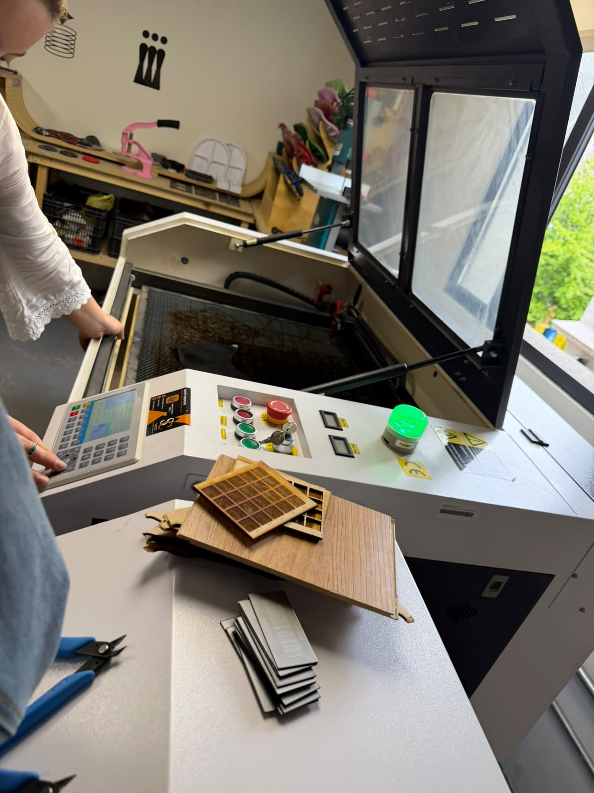
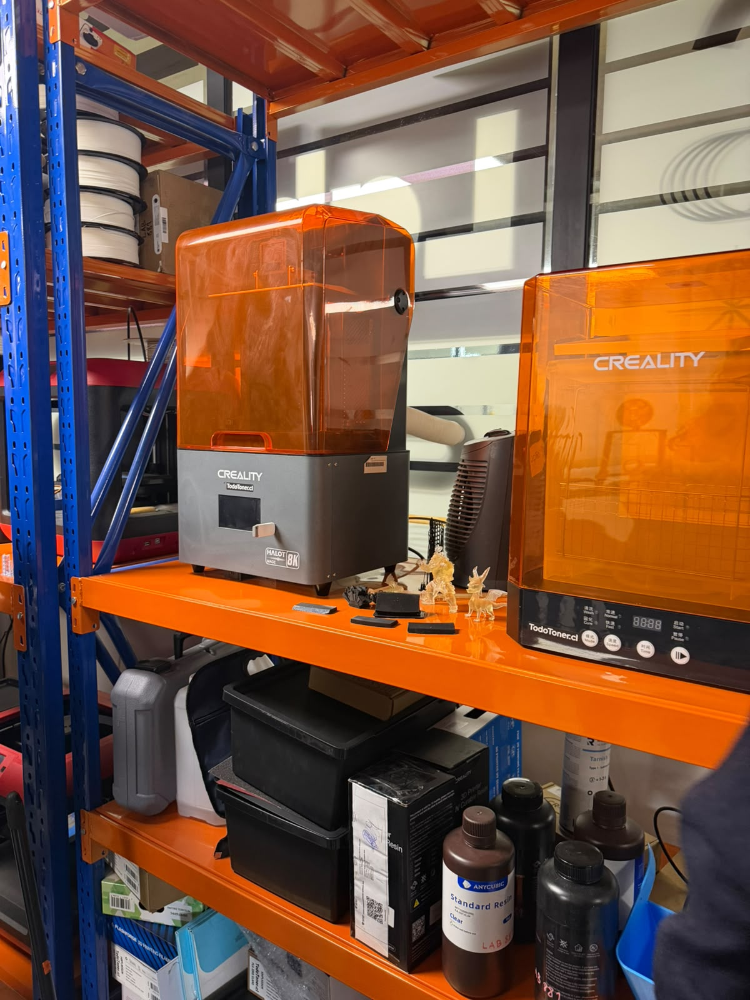
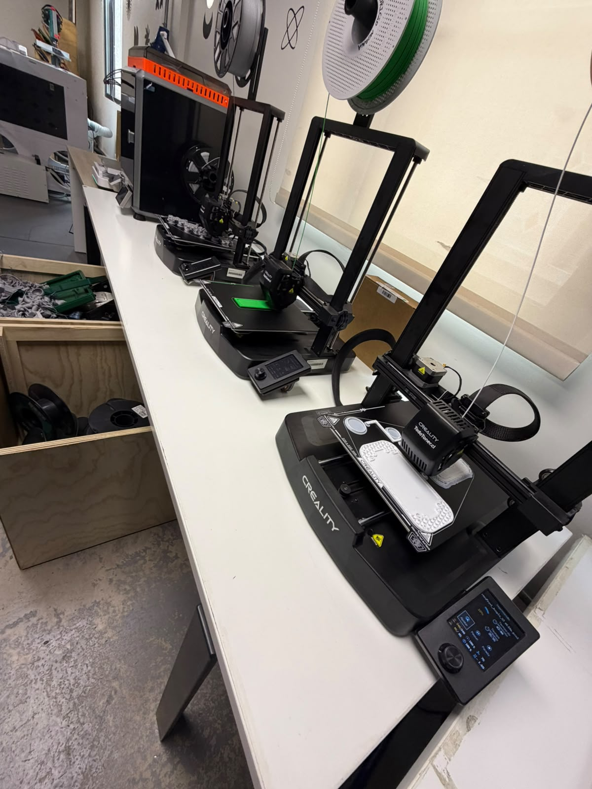
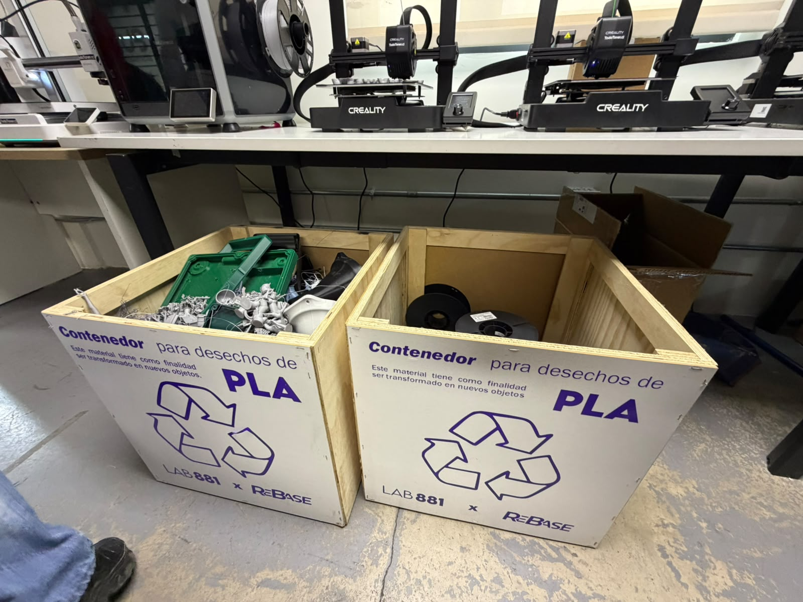
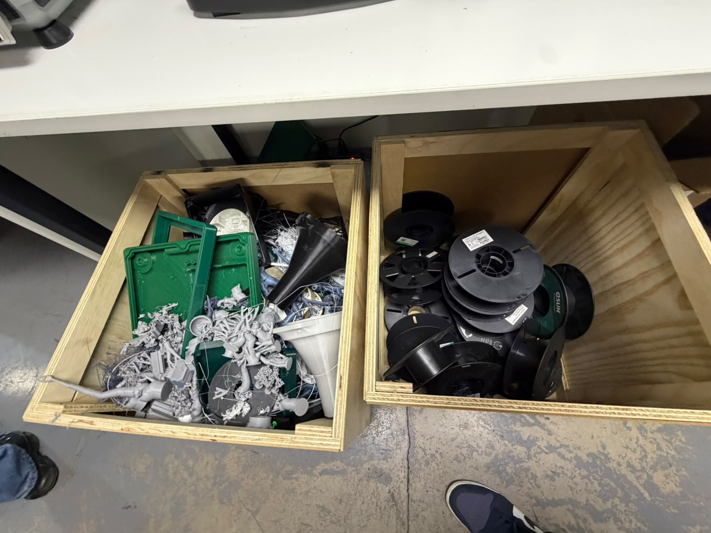
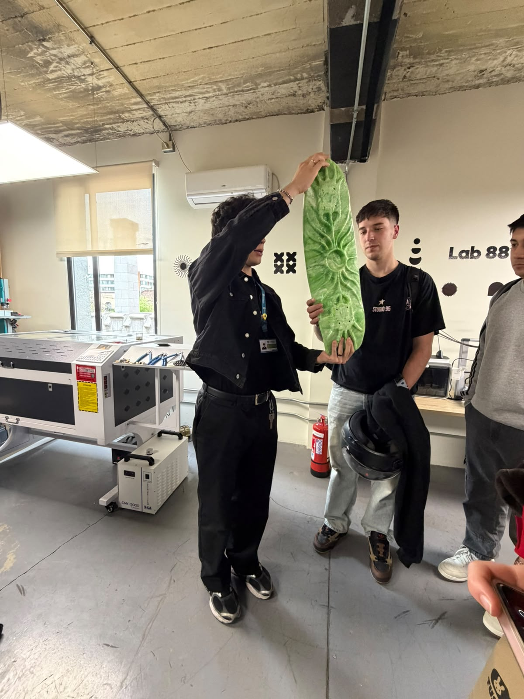
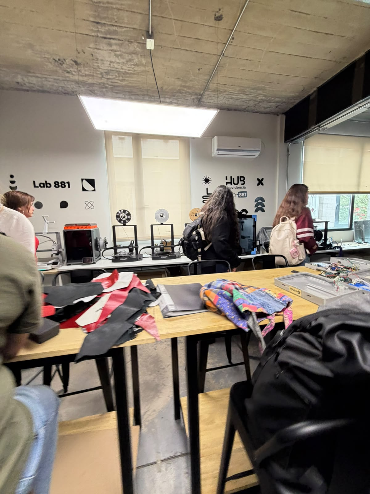
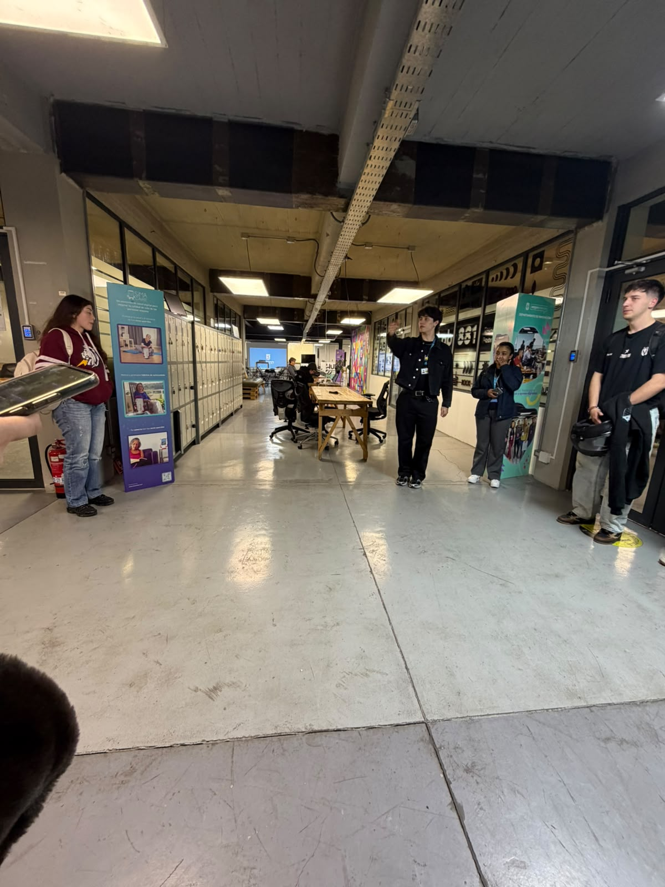

# S07 — Visita técnica al Hub Providencia

**Proyecto:** EcoFab Lab
**Semana:** 7
**Fecha:** 24 de septiembre de 2026
**Actividad:** Visita técnica, recorrido por el laboratorio y entrevista al personal
**Lugar:** Hub Providencia

## Objetivo de la actividad

Conocer las prácticas de fabricación digital desarrolladas en el Hub Providencia, identificar los principales residuos generados durante los procesos de impresión 3D y corte láser, y explorar alternativas de reutilización y valorización de materiales que puedan contribuir al desarrollo del proyecto EcoFab Lab.

---

## Contexto de la semana

Durante la séptima semana del proyecto EcoFab Lab se realizó una visita técnica al Hub Providencia, donde se recorrieron las instalaciones y se conversó con el personal encargado del laboratorio. La actividad permitió observar los equipos utilizados en los procesos de fabricación digital, conocer los residuos generados y recopilar información sobre las prácticas actuales de gestión de materiales.

Durante el recorrido se observaron impresoras 3D, recipientes con residuos de impresión y equipos utilizados en otros procesos de fabricación digital, incluida una cortadora láser. Además, se conocieron ejemplos de productos elaborados a partir de excedentes de láminas plásticas, lo que permitió identificar posibles referentes para futuras iniciativas de valorización de residuos.

La visita se complementó con preguntas orientadas a conocer los materiales utilizados, las alternativas de reutilización existentes y la cantidad aproximada de residuos generados.

## 1. ¿Qué residuos de fabricación digital generan actualmente?

Según la información entregada por el personal del Hub Providencia, el laboratorio utiliza principalmente PLA en sus procesos de impresión 3D. Se indicó que aproximadamente el 90 % del material utilizado corresponde a este filamento.

El laboratorio dispone de tres impresoras que trabajan exclusivamente con PLA y otro equipo que permite utilizar múltiples filamentos. Durante la visita también se identificó la necesidad de considerar otros residuos asociados a los procesos de fabricación digital, especialmente aquellos provenientes de la resina y de la cortadora láser.

Entre los residuos observados se encuentran restos plásticos y piezas provenientes de la impresión 3D. Estos pueden originarse por impresiones fallidas, soportes, sobrantes de material y pruebas de fabricación.

La información recopilada permitió establecer que el PLA constituye el material prioritario para estudiar alternativas de recuperación. Sin embargo, también es necesario diferenciar los residuos según su composición y origen, ya que no todos pueden gestionarse de la misma manera.

En particular, el manejo de los residuos de resina representa una dificultad que todavía requiere una alternativa adecuada.

## 2. ¿Qué hacen actualmente con los residuos de resina y los residuos de la cortadora láser?

Durante la conversación se identificó una posible referencia para la valorización de materiales plásticos: un proyecto denominado **REBASE**, relacionado con la compra y transformación de excedentes de láminas plásticas para elaborar nuevos productos.

Durante la visita se observaron ejemplos de productos y prototipos de skate elaborados utilizando sobrantes de láminas plásticas. Estos ejemplos demostraron que ciertos materiales descartados pueden convertirse en materia prima para desarrollar nuevos productos.

Sin embargo, es importante precisar que los prototipos observados no fueron fabricados con residuos generados por el laboratorio del Hub Providencia. En el momento de la visita todavía no existía una colaboración establecida entre ambas iniciativas para aprovechar dichos residuos.

Por lo tanto, REBASE se considera una posible referencia para explorar alternativas de valorización, pero no una solución actualmente implementada para los residuos del Hub.

En cuanto a los residuos de resina, no se identificó una solución definida durante la visita. Este material requiere una evaluación específica de sus características y de las condiciones de manipulación y disposición correspondientes.

Respecto de los residuos de la cortadora láser, también será necesario identificar los materiales procesados y determinar qué fracciones podrían recuperarse o reutilizarse de manera segura y técnicamente viable.

## 3. ¿Tienen alguna estimación aproximada de cuánto se genera semanal o mensualmente?

El personal explicó que la cantidad de residuos generados depende de distintos factores, entre ellos la cantidad de impresiones realizadas, el tamaño de las piezas fabricadas y las fallas que pueden producirse durante el proceso.

Por esta razón, el volumen de residuos puede variar entre una semana y otra, sin mantener necesariamente una cantidad constante.

Durante la visita no se obtuvo una estimación cuantitativa específica de la generación semanal o mensual. Esta ausencia de datos representa una oportunidad de mejora, ya que contar con registros periódicos permitiría comprender mejor la magnitud del problema y evaluar el impacto de las alternativas de reutilización.

Para obtener información más precisa, sería conveniente registrar periódicamente la cantidad de residuos generados, diferenciándolos según el material, el proceso de origen y su posible destino.

## Recorrido por el laboratorio y observaciones en terreno

Durante el recorrido por las instalaciones del Hub Providencia se realizaron las siguientes observaciones:

- **Equipos de impresión 3D:** se conocieron las impresoras disponibles y se obtuvo información sobre los materiales utilizados en los procesos de fabricación.
- **Residuos de impresión:** se observaron recipientes con restos de material plástico y residuos asociados a la impresión 3D.
- **Predominio del PLA:** el personal indicó que este material representa aproximadamente el 90 % del material utilizado en el laboratorio.
- **Cortadora láser:** se observó el área de trabajo y se identificó la necesidad de estudiar los residuos generados por este proceso.
- **Productos fabricados con láminas plásticas:** se conocieron ejemplos de productos y prototipos elaborados a partir de excedentes de láminas, como referencia para explorar nuevas posibilidades de valorización.
- **Gestión de residuos:** se identificó la necesidad de profundizar en las alternativas disponibles para los distintos materiales, especialmente la resina.

Estas observaciones permitieron complementar la información entregada por el personal con evidencia visual del entorno de trabajo y de los materiales presentes en el laboratorio.

## Principales hallazgos

A partir de la entrevista y del recorrido, se identificaron los siguientes hallazgos:

1. El PLA es el material predominante en las actividades de impresión 3D del laboratorio, con una proporción aproximada del 90 % según lo informado por el personal.
2. La generación de residuos depende de la cantidad de impresiones, del tamaño de las piezas y de las fallas que ocurren durante la fabricación.
3. Durante la visita no se obtuvo una cifra exacta de generación semanal o mensual de residuos.
4. Existen iniciativas, como REBASE, que transforman excedentes de láminas plásticas en nuevos productos.
5. Los productos y prototipos de skate observados constituyen una referencia de valorización de materiales, pero no fueron elaborados con residuos del laboratorio del Hub Providencia.
6. En el momento de la visita no existía una colaboración establecida para destinar los residuos del Hub a REBASE.
7. El manejo de los residuos de resina continúa siendo una necesidad sin una solución definida identificada durante la visita.
8. Los residuos de la cortadora láser requieren una caracterización que permita determinar su composición y sus posibilidades de recuperación.
9. La falta de datos cuantitativos dificulta estimar el volumen total de residuos y evaluar el potencial de las alternativas de reutilización.

## Relación de los hallazgos con el proyecto EcoFab Lab

La información obtenida durante la visita aporta antecedentes relevantes para orientar el desarrollo de EcoFab Lab y definir las siguientes etapas de investigación.

En primer lugar, el predominio del PLA permite priorizar el estudio de los residuos de impresión 3D, considerando su cantidad, composición y condiciones de recuperación. Esto facilitaría determinar si es posible establecer un proceso de clasificación, almacenamiento y aprovechamiento del material.

En segundo lugar, la experiencia observada en la elaboración de productos a partir de excedentes de láminas plásticas demuestra que existen alternativas de valorización que pueden estudiarse como referencia. No obstante, antes de proponer una colaboración con REBASE será necesario confirmar qué materiales acepta, cuáles son sus requisitos y bajo qué condiciones podría recibir residuos del laboratorio.

En tercer lugar, la situación de los residuos de resina evidencia que no todos los materiales pueden abordarse mediante una única estrategia de reutilización. Será necesario investigar opciones específicas de manejo y disposición, considerando las condiciones de seguridad correspondientes.

Finalmente, la ausencia de registros cuantitativos refuerza la importancia de implementar un sistema de seguimiento que permita conocer la cantidad de residuos generados y evaluar los resultados de futuras medidas de aprovechamiento.

## Próximos pasos

A partir de los resultados de la visita, se proponen las siguientes acciones:

- [ ] Investigar las condiciones bajo las cuales REBASE podría recibir y valorizar materiales provenientes del laboratorio.
- [ ] Identificar los tipos de residuos generados por la cortadora láser y evaluar sus posibilidades de recuperación.
- [ ] Investigar alternativas adecuadas para el manejo y la disposición de los residuos de resina.
- [ ] Diseñar un registro periódico de residuos que permita documentar el material, la cantidad, el proceso de origen y el destino.
- [ ] Evaluar la viabilidad técnica de separar y almacenar los residuos de impresión 3D según su composición.
- [ ] Utilizar los antecedentes y registros de la visita como base para definir posibles estrategias de valorización dentro de EcoFab Lab.

---

## Evidencias fotográficas de la visita

Las siguientes fotografías documentan el recorrido por el Hub Providencia, los equipos de fabricación digital y los materiales observados durante la actividad.

### 1. Registro del equipo

  

*Figura 1. Equipo de EcoFab Lab durante la visita técnica al Hub Providencia.*

### 2. Equipos de fabricación digital

  

*Figura 2. Cortadora láser observada durante el recorrido.*

  

*Figura 3. Equipo relacionado con los procesos de fabricación digital.*

  

*Figura 4. Equipos de impresión 3D utilizados en el laboratorio.*

### 3. Residuos de impresión 3D

  

*Figura 5. Recipientes utilizados para reunir materiales y residuos de PLA.*

  

*Figura 6. Residuos plásticos observados durante la visita.*

### 4. Valorización de materiales plásticos

  

*Figura 7. Prototipo de skate observado como ejemplo de valorización de excedentes de láminas plásticas. Este producto no fue elaborado con residuos del laboratorio del Hub Providencia.*

### 5. Instalaciones y área de trabajo

  

*Figura 8. Área de trabajo y materiales presentes en el laboratorio.*

  

*Figura 9. Registro del recorrido por las instalaciones del Hub Providencia.*

---

## Conclusión

La visita técnica al Hub Providencia permitió conocer de manera directa los procesos de fabricación digital, los materiales utilizados y algunos de los residuos generados en el laboratorio. La información proporcionada por el personal permitió identificar que el PLA es el material predominante y que la cantidad de residuos depende de las características y los resultados de cada proceso de fabricación.

Asimismo, se conocieron ejemplos de valorización de excedentes de láminas plásticas mediante iniciativas como REBASE. Estos ejemplos constituyen una referencia útil para EcoFab Lab, aunque durante la visita no existía una colaboración que permitiera destinar los residuos del Hub a dicha iniciativa.

Por otra parte, el manejo de los residuos de resina y la falta de registros cuantitativos continúan siendo aspectos que requieren investigación. En consecuencia, los próximos esfuerzos deberán centrarse en caracterizar los materiales, cuantificar los residuos generados y evaluar alternativas de recuperación y disposición que sean técnicamente viables y adecuadas para cada tipo de material.
