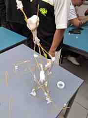

# 📘 Sesión 11 — Desafío del Marshmallow: construcción y prototipado rápido

> **Fecha:** 05/11/2026  
> **Integrantes:** Equipo EcoFab Lab  
> **Actividad:** Desafío del Marshmallow  
> **Contexto:** Capstone Intermedio 2026 · Unidad 3

## 🎯 Objetivo de la actividad

Participar en una actividad práctica de prototipado rápido para poner a prueba la organización, la colaboración y la capacidad de construir, probar y mejorar una idea en equipo. El desafío también permite reflexionar sobre cómo estos aprendizajes se pueden aplicar al desarrollo de la solución de EcoFab Lab.

## 🧩 ¿En qué consistió el desafío?

La actividad consistió en construir, en equipo, una torre autoportante que pudiera sostener un marshmallow completo en la parte superior. Para realizarla se utilizaron materiales simples:

- 18 espaguetis crudos.
- 1 metro de cinta adhesiva.
- 1 marshmallow.

La estructura debía mantenerse de pie por sí sola, sin apoyarse en las manos, paredes u otros elementos externos. El objetivo era conseguir la torre estable de mayor altura, manteniendo el marshmallow en la parte superior.

## 🛠️ Desarrollo de la actividad

Como equipo, comenzamos a construir una estructura utilizando los espaguetis como elementos principales y cinta adhesiva para unir y afirmar las distintas partes. Durante el proceso fuimos levantando la torre y conectando sus componentes para conseguir una estructura que se mantuviera en pie y pudiera soportar el peso del marshmallow.

La fotografía de la actividad muestra parte del proceso de construcción: se observan los elementos unidos mediante cinta, la estructura levantada sobre la mesa y los materiales utilizados durante el armado.

Este ejercicio permitió trabajar directamente con un prototipo físico, en lugar de quedarnos solamente en una idea o un diseño en papel.

## 🔍 Relación con el proyecto EcoFab Lab

Aunque el desafío utiliza materiales diferentes a los de nuestra propuesta, la actividad se relaciona con el trabajo que estamos desarrollando porque nos permite practicar una forma de trabajo que también necesitaremos para las estaciones ecológicas:

- **Probar antes de dar algo por terminado:** una idea debe llevarse a una construcción o prueba para reconocer si funciona como esperamos.
- **Detectar dificultades durante el armado:** al construir una estructura pueden aparecer problemas de estabilidad o unión que no siempre se identifican al planificar.
- **Tomar decisiones en equipo:** es importante conversar, distribuir tareas y ponerse de acuerdo sobre cómo avanzar.
- **Ajustar a partir de lo observado:** las pruebas permiten reconocer qué se debe modificar antes de continuar.
- **Trabajar con recursos limitados:** el desafío exige organizar los materiales disponibles y utilizarlos de manera eficiente.

Estos aprendizajes son útiles para EcoFab Lab, ya que nuestra propuesta de estaciones ecológicas también necesitará pasar por una etapa de diseño, construcción de prototipo y pruebas antes de poder evaluar su funcionamiento.

## 💡 Aprendizajes de la actividad

La actividad nos permitió reconocer que el prototipado es una instancia para aprender haciendo. No basta con imaginar una estructura o asumir que una solución funcionará: es necesario construirla, observar su comportamiento y realizar ajustes cuando sea necesario.

También reforzamos la importancia de coordinarnos como equipo, escuchar distintas ideas y tomar decisiones durante el desarrollo de una tarea práctica.

En relación con EcoFab Lab, nos llevamos la idea de que debemos probar los componentes de nuestra propuesta de manera progresiva. Por ejemplo, antes de pensar en una estación completa, podemos construir y probar por separado el contenedor, la identificación de residuos y el sistema de pesaje.

## ➡️ Próximos pasos

- [ ] Aplicar el enfoque de prototipado rápido al diseño de las estaciones ecológicas.
- [ ] Definir qué componente de la propuesta conviene construir y probar primero.
- [ ] Registrar los materiales, dificultades, ajustes y resultados de cada prueba.
- [ ] Establecer criterios sencillos para evaluar si el prototipo cumple su función.
- [ ] Incorporar fotografías y evidencias de las siguientes pruebas del proyecto.

## 📷 Evidencias fotográficas

**Fotografía 1 — Construcción y trabajo en equipo:** se observa al equipo armando y ajustando la estructura con espaguetis y cinta adhesiva. La imagen permite apreciar el proceso colaborativo y las pruebas de estabilidad durante la construcción.

**Fotografía 2 — Estructura construida:** se observa la torre en una etapa más avanzada, con el marshmallow ubicado en la parte superior y distintos puntos de unión reforzados con cinta adhesiva.

## ✅ Conclusión

El Desafío del Marshmallow fue una actividad práctica para ejercitar el prototipado rápido, la colaboración y el aprendizaje a partir de la construcción. Para EcoFab Lab, este ejercicio refuerza la importancia de pasar de una propuesta a un prototipo que podamos probar y mejorar con evidencia. La experiencia nos sirve como referencia para organizar el desarrollo de las estaciones ecológicas y comprobar progresivamente si sus componentes responden a las necesidades identificadas en el Lab881.
